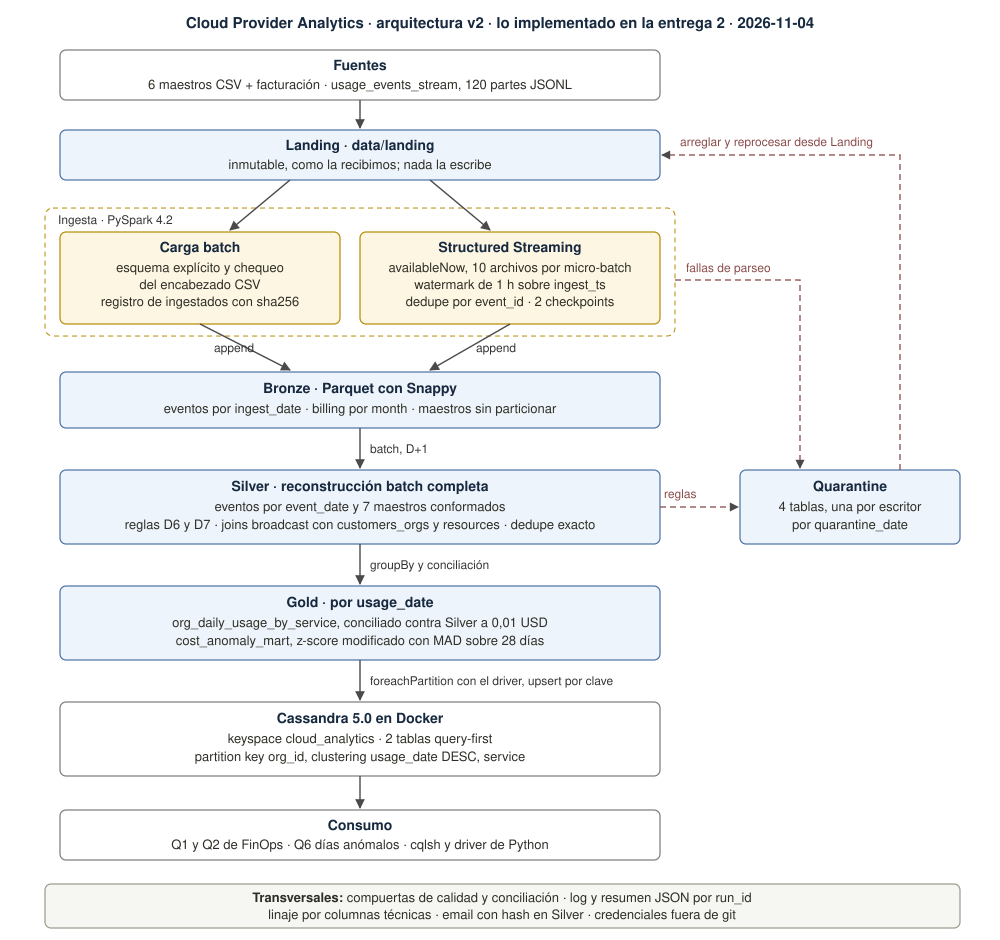

# Cloud Provider Analytics, entrega 2

Proyecto integrador de Big Data, ITBA, segundo cuatrimestre 2026.
Segunda entrega: implementación técnica y MVP end-to-end mínimo. Versión 1, 2026-11-08.

Grupo 11: Ivan Odzomek, Lucas Campoli, Matias Sapino, Diego Rabinovich, Diego Badin.

El pipeline corre de punta a punta sobre los datos provistos: Landing, Bronze, Silver, Gold y
Cassandra, con batch y streaming, reglas de calidad con Quarantine, un mart FinOps, un componente de
anomalías y evidencia de idempotencia. Este documento resume lo implementado y remite a la
evidencia. Los pasos exactos para correrlo están en el `README.md`, las decisiones en
`DECISIONS.md` y los reportes generados en `evidence/entrega-2/`.

## 1. Qué cambió desde la entrega 1

La entrega 1 no tuvo correcciones de la cátedra. Lo que cambió en el diseño viene de implementarlo:

| Cambio | Por qué | Decisión |
| :--- | :--- | :--- |
| La vista intradía provisoria (speed layer) no está, y sale del diagrama | la entrega 2 pide el mart diario; queda en el backlog | D3 |
| El streaming corre con `availableNow` y `processingTime="1 minute"` queda como modo continuo | el pipeline se corre entero, se re-ejecuta y se muestra en vivo | D14 |
| Gold particiona por `usage_date` | es la fecha del evento con el nombre del grano del mart | D5 |
| Los maestros de Bronze particionan por `ingest_date` | cada snapshot queda en el día en que se cargó y la retención borra directorios enteros | D5 |
| La carga a Cassandra usa el driver de Python desde `foreachPartition` | el conector oficial no tiene versión para Spark 4 | D16 |
| Quarantine son cuatro tablas, una por escritor, con `rule_name` | el sink del stream es dueño de su carpeta y las reglas se reconstruyen | D15 |
| Nueva regla de rechazo `resource_org_mismatch` | un recurso de otra organización es una contradicción entre claves | D6 |
| El dedupe del stream usa un hash del contenido cuando falta `event_id` | los nulos se agrupan entre sí y colapsarían filas distintas | D14 |
| Registro de ingestados con sha256, dedupe por clave en Silver | idempotencia de la carga batch | D13 |
| `users.email` se reemplaza por un hash con sal en Silver | es el único dato personal | D17 |
| D11 y D12 cerradas con los conteos de Gold | estaban abiertas a propósito | D11, D12 |
| Spark local en WSL, Cassandra en Docker | el supuesto de §8.1 del diseño preveía este cambio | D16 |

## 2. Arquitectura v2



La figura muestra solo lo que corre. El diseño es el híbrido estilo Lambda de D3, y en esta entrega
están implementados el batch layer y la ingesta streaming a Bronze. El streaming hace append a
Bronze y todo lo demás es batch, porque un watermark sobre el tiempo del evento descartaría casi
todos los eventos (§3.1). El speed layer, la vista intradía provisoria, está diferido y no aparece en
la figura, así que la latencia de Gold y de Cassandra es D+1. El serving tiene dos destinos probados con el
mismo cargador (D16): Cassandra 5.0 en Docker, que es el principal, y AstraDB, que se elige por
configuración.

| Etapa | Comando | Entrada | Salida |
| :--- | :--- | :--- | :--- |
| Carga batch | `make bronze` | 7 CSV de Landing | `bronze/<maestro>`, `quarantine/masters_parse` |
| Streaming | `make stream` | `usage_events_stream/*.jsonl` | `bronze/usage_events`, `quarantine/usage_events_parse` |
| Silver | `make silver` | Bronze | `silver/*`, `quarantine/*_rules` |
| Gold | `make gold` | Silver | `gold/org_daily_usage_by_service`, `gold/cost_anomaly_mart` |
| Serving | `make serve` y `make queries` | Gold | 2 tablas en Cassandra y en AstraDB, salidas de Q1, Q2 y Q6 |

`make run` corre todas las etapas en orden. Cada corrida tiene un `run_id`, escribe
`logs/<run_id>.log` y un resumen JSON con la configuración, el commit y las métricas de cada etapa, y
termina con código 1 si alguna etapa falla.

## 3. Procesamiento con Spark

### 3.1 Bronze

La carga batch lee cada CSV con su `StructType`, compara el encabezado con el esquema
(`enforceSchema=false`) y manda a Quarantine, con la línea cruda, lo que no parsea. Agrega
`ingest_ts`, `ingest_date` y `source_file` (desde `_metadata.file_name`). Billing particiona por
`month` y los otros seis maestros por `ingest_date`, una partición por snapshot cargado (D5).

El streaming son dos queries sobre el mismo directorio, cada una con su `queryName` y su checkpoint,
que leen solo los `*.jsonl` (`pathGlobFilter`), así un `:Zone.Identifier` copiado desde Windows no
corta el stream (D14). La de Bronze separa primero las fallas de parseo, después hace
`withWatermark("ingest_ts", "1 hour")` y `dropDuplicatesWithinWatermark` sobre la clave de dedupe, y
escribe un archivo por micro-batch. Sobre los datos reales:

| Medida | Valor |
| :--- | ---: |
| micro-batches con datos | 12, de 10 archivos y 3.600 eventos cada uno |
| eventos en Bronze | 43.200 |
| filas descartadas por el watermark | 0 |
| filas en el estado del dedupe al final | 43.200 (todas llegaron dentro de la hora) |
| re-ejecución con el mismo checkpoint | 0 filas leídas |
| experimento con watermark de 2 s | 0 descartadas, estado máximo 24.480 claves, 24.480 liberadas |

El experimento (`make stream-state-demo`, 4 archivos por micro-batch) es la prueba empírica de D8:
el estado se libera a medida que avanza el watermark y Bronze sigue recibiendo todos los eventos.
Como el watermark avanza con `ingest_ts`, el estado máximo depende del reloj y cambia entre
corridas. Lo que no cambia es que no se descarta ningún evento.

El stream no maneja late data. El watermark va sobre `ingest_ts`, que se sella al leer, así que
ningún evento llega tarde contra él, y solo acota cuánto tiempo el dedupe recuerda un `event_id`.
El late data se resuelve después: Bronze conserva todos los eventos y Silver ubica cada uno en la
partición de su `event_date`. Para medir cuánto late data hay, `stream_bronze.md` vuelve a pasar
Bronze por un watermark sobre `timestamp`, con un archivo por micro-batch y con los 12
micro-batches reales de la corrida:

| Watermark sobre `timestamp` | Tardíos con 1 archivo por micro-batch | Tardíos con 10 archivos (corrida real) |
| :--- | ---: | ---: |
| 1 día | 42.118 (97,5%) | 38.940 (90,1%) |
| 7 días | 37.831 (87,6%) | 34.984 (81,0%) |

Con 10 archivos el watermark avanza una vez cada 10 partes y los eventos de un mismo micro-batch no
se comparan entre sí, por eso hay menos tardíos. Spark arma los micro-batches por fecha de
modificación de los archivos, que depende de cómo se copió el dataset: en nuestra copia
`events_part_0045` entró en el primero. Con bloques de 10 por nombre el resultado es 38.935, cinco
eventos menos. Cada micro-batch se identifica en Bronze por su `ingest_ts`, así que el cálculo sale
de `make evidence`.

### 3.2 Silver

Silver se reconstruye entero desde Bronze en cada corrida (D8). Los maestros se quedan con la última
fila por clave natural y reciben las reparaciones de D7. Los eventos pasan por:

1. Conformación de `service`, `region`, `metric` y `unit` (minúsculas y sin espacios).
2. Dos joins broadcast, contra `customers_orgs` y `resources`, que agregan industria, plan, estado
   del recurso y dueño del recurso. Un join sin match o un recurso de otra organización son reglas
   de rechazo.
3. Las 8 reglas de rechazo, la imputación de `unit` y el `try_cast` de `value` (D2, D6).
4. Dedupe exacto por `event_id` con una ventana que conserva la primera fila por `ingest_ts`.
5. Features: `requests`, `cpu_hours` y `storage_gb_hours` como una columna por métrica, más
   `cost_usd_increment`, `genai_tokens` y `carbon_kg`.

Silver queda particionado por `event_date`, con 60 particiones y un archivo de unos 46 KB por día.

### 3.3 Gold y el plan de ejecución

`org_daily_usage_by_service` es un `groupBy(org_id, usage_date, service).agg(...)` con
`daily_cost_usd`, `requests`, `cpu_hours`, `storage_gb_hours`, `genai_tokens`, `carbon_kg`, `events`,
`negative_cost_events` y `unit_imputed_events`. `F.sum` devuelve null cuando todas las entradas son
nulas, que es el par suma y conteo del §7 del diseño. Antes de escribir, el mart se concilia contra
Silver: si alguna organización y día difiere en más de 0,01 USD, si hay claves nulas o si la
cantidad de filas no es la del grano, la corrida falla y no publica.

| Control | Resultado |
| :--- | ---: |
| filas en Gold | 11.050 |
| claves del grano en Silver | 11.050 |
| eventos sumados en Gold | 43.200 |
| organización-días comparados | 4.580 |
| diferencia máxima | 0,00 USD |

El plan físico (`gold_explain.txt`) es el job de MapReduce del §7:

| Nodo del plan | Etapa de MapReduce |
| :--- | :--- |
| `Scan parquet` que lee 11 de las 28 columnas de Silver (poda de columnas) | input splits y lectura del map |
| `HashAggregate` con `partial_sum` y `partial_count` | combiner, suma local por tarea |
| `Exchange hashpartitioning(org_id, event_date, service, 8)` | partitioner y shuffle sobre la clave compuesta. `event_date` es la columna de Silver; el alias `usage_date` se aplica recién en el `HashAggregate` final (`event_date AS usage_date`), así que es la misma fecha con el nombre del grano del mart |
| `HashAggregate` con `sum` y `count` | reduce |
| `AdaptiveSparkPlan` | AQE ajusta las particiones del shuffle después de medirlas |

El hash cubre la clave completa, como en §7.3, y gracias al combiner el shuffle mueve una fila por
clave y tarea, no un evento.

### 3.4 Particiones y archivos

| Tabla | Partición | Particiones | Archivos | Tamaño medio |
| :--- | :--- | ---: | ---: | ---: |
| `bronze/usage_events` | `ingest_date` | 1 | 12 | 148 KB |
| `silver/usage_events` | `event_date` | 60 | 60 | 46 KB |
| `gold/org_daily_usage_by_service` | `usage_date` | 60 | 60 | 10 KB |
| `gold/cost_anomaly_mart` | `usage_date` | 60 | 60 | 10 KB |

El inventario completo, con filas y bytes por tabla, está en `lake_inventory.md`.

## 4. Calidad y Quarantine

| Regla | Dónde | Acción | Datos reales | Fixtures |
| :--- | :--- | :--- | ---: | ---: |
| la línea no parsea (JSON o CSV) | Bronze | Quarantine | 0 | 3 |
| `event_id` nulo | Silver | Quarantine | 0 | 1 |
| `event_id` duplicado | stream y Silver | dedupe | 0 | 1 |
| `timestamp` nulo, `metric` desconocido, `unit` contra `metric`, `value` que no castea | Silver | Quarantine | 0 | 4 |
| `org_id` o `resource_id` sin match, recurso de otra organización | Silver | Quarantine | 0 | 3 |
| `cost_usd_increment` < -0,01 | Silver | `cost_anomaly_flag` | 211 | 1 |
| `unit` nulo con `metric` conocido | Silver | imputar, `unit_imputed` | 2.075 | 1 |
| ticket resuelto antes de creado | Silver | Quarantine | 0 | 1 |
| CSAT, NPS, tasa USD, créditos, subtotal, timestamps de users, conversión sin clic | Silver | anular, reparar o marcar (D7) | 40, 1, 160, 137, 13, 232 y 249, 96 | 1 cada una |

Las tres reglas de la consigna se cumplen en Silver: 0 `event_id` nulos y 0 duplicados, 211 costos
negativos marcados, y los 42.323 eventos con `value` tienen `unit`, o sea el 100% después de la
imputación. Quarantine queda en 0% de los eventos y 0% del costo, contra el 1% de O3. Con los datos
reales Quarantine queda vacía, así que las muestras salen de los fixtures de `tests/fixtures/landing/`,
que ejercitan cada regla con un lake aparte (D10). En la demo se muestran con `make fixtures`. Tres filas de Quarantine, recortadas:

| Tabla | `rule_name` | `source_file` | `raw_record` |
| :--- | :--- | :--- | :--- |
| `quarantine/usage_events_parse` | `parse_type_mismatch` | `events_fixture_0000.jsonl` | `{"event_id": "evt_fixture_ts", "timestamp": "not-a-timestamp", ...}`, la línea cruda |
| `quarantine/usage_events_rules` | `value_not_castable` | `events_fixture_0000.jsonl` | `{"event_id":"evt_fixture_value", ..., "metric":"cpu_hours", "value":"n/a", "unit":"hours", ...}`, la fila de Bronze |
| `quarantine/masters_rules` | `resolved_before_created` | `support_tickets.csv` | `{"ticket_id":"tkt_fixture02", ..., "created_at":"2025-07-05", "resolved_at":"2025-07-02", ...}` |

Una muestra completa de cada regla, con su `raw_record`, está en `quarantine_samples.md`.

## 5. Serving en Cassandra y AstraDB

Cassandra 5.0 corre en Docker (`infra/docker-compose.yml`). El keyspace y las tablas están en
`cql/`, y las consultas en `cql/q*.cql`. AstraDB es el segundo destino, con el mismo esquema y el
mismo cargador.

| Consulta | Tabla | Partition key | Clustering | Lectura |
| :--- | :--- | :--- | :--- | :--- |
| Q1, costo y requests diarios por servicio en un rango | `org_daily_usage_by_service` | `org_id` | `usage_date DESC`, `service` | un rango dentro de una partición |
| Q2, top-N de servicios por costo en 14 días | `org_daily_usage_by_service` | `org_id` | `usage_date DESC`, `service` | 14 días de una partición (84 filas como máximo), suma y orden en el cliente |
| Q6, días anómalos | `cost_anomalies_by_org` | `org_id` | `usage_date DESC`, `service` | un rango de una partición, filtro `is_anomaly` en el cliente |

Replicación local: `NetworkTopologyStrategy` con `dc1: 1`. En producción sería `dc1: 3` con
`LOCAL_QUORUM` para leer y escribir. Una partición tiene como máximo 6 filas por día, así que crece
a unas 2.190 filas por año sin importar el tamaño de la organización, y no hace falta un bucket por
mes (D11). La carga verifica, organización por organización, filas y costo contra Gold. Las 80
organizaciones y las 11.050 filas coinciden en las dos tablas.

Q1 para `org_okep7y6w` del 1 al 7 de agosto, como está en `cql/q1_daily_cost_by_service.cql` y
como lo devuelve cqlsh (primeras filas de 25, `serving_q1_cqlsh.txt`):

```text
SELECT usage_date, service, daily_cost_usd, requests, events
FROM cloud_analytics.org_daily_usage_by_service
WHERE org_id = 'org_okep7y6w'
  AND usage_date >= '2025-08-01' AND usage_date <= '2025-08-07';

 usage_date | service    | daily_cost_usd | requests | events
------------+------------+----------------+----------+--------
 2025-08-07 |    compute |       191.8968 |      212 |      3
 2025-08-07 | networking |         3.8985 |      378 |      6
 2025-08-06 | networking |         0.3809 |     null |      3
...
(25 rows)
```

Q2 es la misma lectura con `usage_date` del 18 al 31 de agosto: 54 filas de la partición que el
cliente suma y ordena (`serving_q2_driver.txt`):

```text
rank | service  | cost_14d_usd | days_with_usage
-----+----------+--------------+----------------
1    | genai    | 211.0267     | 10
2    | storage  | 117.8743     | 13
3    | database | 90.8801      | 9
```

El `null` de `requests` es un día sin requests medidos, no un cero (D6). Las salidas completas, por
cqlsh y por el driver, están en `serving_q1_*`, `serving_q2_*` y `serving_q6_*`.

AstraDB se probó con la misma carga, cambiando solo la conexión: `SERVING_TARGET=astra`, el secure
connect bundle por ruta, el usuario `token` y el token como contraseña, todo por variables de entorno
y fuera del repo. El keyspace `cpa` se creó desde la consola, porque AstraDB no admite
`CREATE KEYSPACE`, y las tablas salen del mismo `cql/01_tables.cql`. Cargamos Gold dos veces:

| Tabla en AstraDB | Primera carga | Segunda carga | Gold |
| :--- | ---: | ---: | ---: |
| `cpa.org_daily_usage_by_service` | 11.050 | 11.050 | 11.050 |
| `cpa.cost_anomalies_by_org` | 11.050 | 11.050 | 11.050 |

Q1, Q2 y Q6 devuelven sobre AstraDB los mismos resultados que en local (`serving_astra.md`,
`serving_q*_driver_astra.txt`). En la evidencia copiada, el token, el host de la base y las rutas
locales quedan enmascarados.

## 6. Analítica: anomalías de costo

`cost_anomaly_mart` compara el costo de cada día con los 28 días previos de la misma organización y
servicio, con el z-score modificado `0,6745 × (x − mediana) / MAD`. Si MAD es 0, cae a la desviación
absoluta media. Un día con menos de 14 días de historia no se puntúa. El corte es 3,5. El detalle y
las alternativas están en D12.

| Medida | Valor |
| :--- | ---: |
| filas puntuadas | 7.043 de 11.050 (63,7%) |
| días marcados | 180 (2,56% de los puntuados): 138 picos y 42 caídas |
| organizaciones con al menos un día marcado | 69 de 80 |
| caso más alto | `org_okep7y6w`, compute, 2025-08-07: 191,90 USD contra una mediana de 11,27 (score 106,5) |

Para saber qué hace el método con los días que un umbral fijo llamaría extremos, el resumen incluye
un chequeo de detección (`gold_marts.md`, `cost_anomaly_summary.json`):

| Días | Total | Marcados | Puntuados sin marcar | Sin historia |
| :--- | ---: | ---: | ---: | ---: |
| costo diario por encima del p99 de Gold (63,91 USD) | 110 | 39 (35,5%) | 41 | 30 |
| costo diario negativo | 35 | 4 (11,4%) | 15 | 16 |

| Caso | Ejemplo | Por qué |
| :--- | :--- | :--- |
| caro y marcado | `org_g8sbi4q2`, database, 2025-08-05: 142,95 USD, mediana 9,22, score 28,9 | salto contra su propia serie |
| caro sin marcar | `org_ktakpuxq`, compute, 2025-08-06: 108,76 USD, mediana 35,58, score 2,92 | la serie gasta mucho siempre |
| negativo y marcado | `org_0lvsnujz`, analytics, 2025-08-24: -134,24 USD, mediana 15,61, score -10,6 | corrección fuera de escala |
| negativo sin marcar | `org_dhylurtp`, compute, 2025-07-27: -9,00 USD, mediana 19,52, score -1,83 | dentro de la variación de la serie |

Hay tres ejemplos de cada caso en `gold_marts.md`. Que un día caro no se marque es lo esperado de un método relativo: un monto alto para una
organización grande no es raro. Los costos negativos chicos ya quedan cubiertos por el
`cost_anomaly_flag` de cada evento y por `negative_cost_events` en el mart, y el score marca solo los
que se salen de su serie. Los días sin historia son la limitación más concreta: explican 30 de los
días caros y 16 de los negativos que no se marcan.

No forzamos un modelo de Spark ML, porque la planificación pide no hacerlo cuando un método
estadístico responde mejor, y acá responde mejor. La mediana y el MAD casi no se mueven con la cola
larga medida en los incrementos (p99 de 16,69 contra un máximo de 317,43), y cada alerta se explica
contra la historia de su propia serie. Un clustering diría a qué grupo se parece un día, no por qué
es raro para esa organización. Para el final queda como deseable un pipeline de Spark ML con KMeans
que segmente organizaciones por perfil de uso (D12).

## 7. Idempotencia

`make rerun-evidence` resetea el lake y el keyspace, corre el pipeline completo dos veces seguidas y
guarda los conteos después de cada una (`counts_run_1.json`, `counts_run_2.json`,
`idempotency.md`).

| Mecanismo | Qué protege | Resultado de la segunda corrida |
| :--- | :--- | :--- |
| registro de ingestados | Landing a Bronze, batch | los 7 CSV salteados, Bronze sin cambios |
| checkpoints de las dos queries | Landing a Bronze, streaming | 0 archivos nuevos, los mismos 12 commits en cada query |
| reconstrucción y dynamic partition overwrite | Silver y Gold | mismas filas en las 18 tablas del lake |
| Quarantine de reglas sobrescrita entera | Quarantine | sin copias del día anterior |
| upsert por primary key | Cassandra | las mismas 11.050 filas en cada tabla |

## 8. Pruebas, configuración y errores

`make test` corre 44 pruebas con Spark local y sin Cassandra: esquemas sobre la muestra, carga batch
(cuarentena de una fila mala, registro, encabezado que no coincide), streaming (separación antes del
dedupe, nada perdido por el watermark, re-ejecución vacía, un `:Zone.Identifier` en la fuente), cada regla de calidad sobre los
fixtures, Silver de punta a punta, la semántica de nulos de Gold y su conciliación, las anomalías
(MAD, caída a la desviación media, historia mínima, ventana que solo mira hacia atrás) y el parseo
de los CQL, la verificación de Java y la sal obligatoria del hash de emails.

La configuración vive en `config/pipeline.env`, copiado de `config/pipeline.env.example`, y cada
variable se puede pisar desde el entorno. El pipeline acepta Java 17, 21 o 25; la evidencia se
generó con 21. Con 25 corrimos `make check` y 43 de las pruebas, todas en verde; la del
`:Zone.Identifier` solo la corrimos con 21. Los errores esperables (otra
versión de Java, `PII_HASH_SALT` sin definir, Landing incompleto, encabezado CSV distinto del
esquema, Gold que no concilia, Cassandra o AstraDB inaccesibles o sin credenciales) cortan la
corrida con un mensaje en el log y código 1.

## 9. Gobierno y ejecución

La matriz de gobierno está en `docs/governance.md` y la ficha de ejecución en
`docs/execution_sheet.md`. Los dos se incluyen al final de este documento.

## 10. Requisito y evidencia

| Componente de §6.2 | Dónde está | Evidencia |
| :--- | :--- | :--- |
| Correcciones y arquitectura | §1 y §2, `docs/architecture_v2.svg` | sin correcciones de la cátedra; diagrama v2 |
| Batch a Bronze, 3 maestros o más | `src/pipeline/bronze_batch.py` | los 7 CSV en `lake_inventory.md`, `run_1_*.log` |
| Streaming a Bronze | `src/pipeline/bronze_stream.py` | `stream_bronze.md`, `run_1_stream_progress.jsonl`, `stream_state_demo_progress.jsonl` |
| Silver, eventos y un maestro, joins, 3 features | `src/pipeline/silver.py` | `silver_quality.md`, `data_dictionary.md` |
| Calidad, 3 reglas y Quarantine con muestras | `src/pipeline/quality_rules.py`, `tests/fixtures/landing/` | `silver_quality.md`, `quarantine_samples.md` |
| Gold `org_daily_usage_by_service` | `src/pipeline/gold.py` | `gold_marts.md`, `gold_reconciliation.json`, `gold_explain.txt` |
| Serving, keyspace, tabla, carga y dos consultas | `cql/`, `src/pipeline/serving.py`, `src/pipeline/queries.py` | `serving_q1_*.txt`, `serving_q2_*.txt`, `serving_astra.md` |
| Analítica | `src/pipeline/anomalies.py` | `gold_marts.md`, `cost_anomaly_summary.json`, `serving_q6_*.txt` |
| Idempotencia | `make rerun-evidence` | `idempotency.md`, `counts_run_*.json` |
| Gobierno preliminar | `docs/governance.md`, D17 | `data_dictionary.md`, logs con secretos enmascarados |
| Pruebas y reproducibilidad | `tests/`, `Makefile`, `README.md` | `make test`, `run_*.json` |
| Backlog final | §11 | este documento |

El checklist §9.2 y los criterios §6.4, línea por línea, están en
`evidence/delivery_2_checklist.md`.

## 11. Backlog para el MVP final

| Prioridad | Trabajo |
| :--- | :--- |
| Obligatorio | marts `revenue_by_org_month`, `tickets_by_org_date` y `genai_tokens_by_org_date` en Gold, con sus tablas en Cassandra y las consultas Q3, Q4 y Q5 |
| Obligatorio | confirmar con la cátedra si Q3 a Q5 son por organización o globales (§8.1 del diseño) |
| Obligatorio | cargar en AstraDB los marts nuevos del final, con sus consultas |
| Obligatorio | presentación ejecutiva, video y guion de la defensa |
| Deseable | vista intradía provisoria del speed layer con `foreachBatch` (D3, apéndice C) |
| Deseable | job de retención para Bronze (90 días) y Quarantine (180 días) |
| Deseable | Silver incremental por las fechas de evento que tocó cada corrida, en lugar de reconstruir todo |
| Deseable | autenticación y roles en Cassandra, y alertas sobre el resumen de cada corrida |
| Deseable | pipeline de Spark ML con KMeans para segmentar organizaciones por perfil de uso (requests, cómputo, almacenamiento, GenAI, costo), con su métrica de silueta |
| Fuera de alcance | Kafka u otro broker, Delta o Iceberg, Declarative Pipelines, Real-Time Mode, `transformWithState` |
