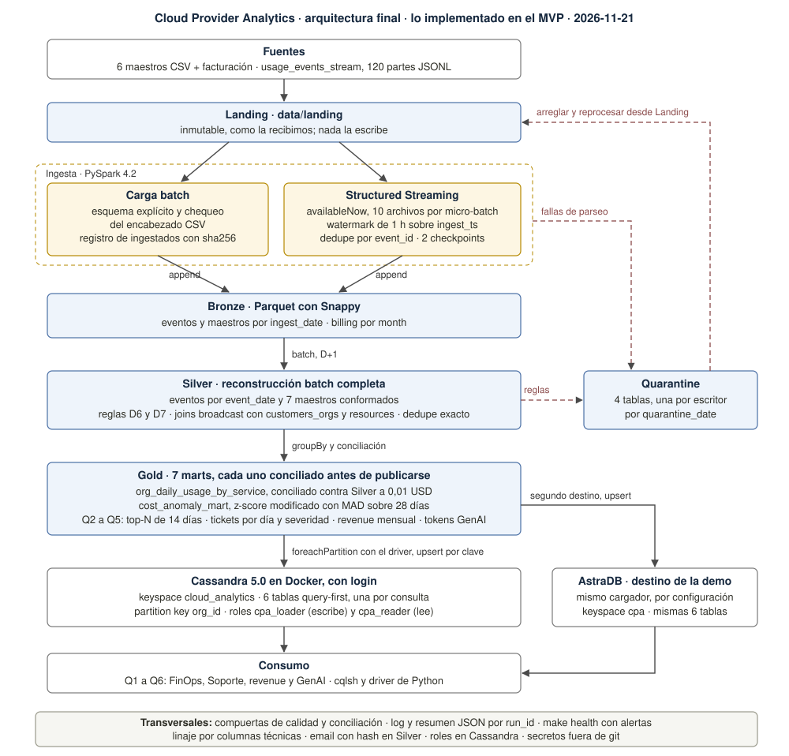

# Cloud Provider Analytics, MVP final

Proyecto integrador de Big Data, ITBA, segundo cuatrimestre 2026.
Evaluación final: MVP integrado, demostración y defensa técnica. Versión 1, 2026-11-21.

Grupo 11: Ivan Odzomek, Lucas Campoli, Matias Sapino, Diego Rabinovich, Diego Badin.

El pipeline corre de punta a punta sobre los datos provistos: Landing, Bronze, Silver y Gold en
Parquet, con ingesta batch y Structured Streaming, reglas de calidad con Quarantine, siete marts, un
componente de anomalías y serving en Cassandra y AstraDB para las cinco consultas obligatorias y
una de anomalías. Este documento resume la solución y remite a la evidencia. Los pasos exactos para
correrla están en el `README.md`, las decisiones en `DECISIONS.md` y la evidencia en
`evidence/final/`.

## 1. Qué cambió desde la entrega 2

La entrega 2 tuvo un 10. La mejora que marcó la cátedra fue Q2: se leían hasta 14 días de una
partición y el cliente sumaba y ordenaba. Pasó a una tabla Top-N precalculada. El resto es el
alcance del final.

| Cambio | Por qué | Decisión |
| :--- | :--- | :--- |
| Q2 sale de `top_services_14d_by_org`, precalculada y rankeada, con `LIMIT N` | modelo query-first: la consulta no agrega en el cliente | D11 |
| Marts de Soporte, revenue y GenAI, más el diario de tickets que sirve a Q3 | Q3, Q4 y Q5 de la consigna (§7.3, §7.4) | D18 |
| Q3, Q4 y Q5 en Cassandra y AstraDB, por organización | el supuesto del diseño, con la misma partition key que Q1 | D11 |
| Cassandra local con login y dos roles de permisos mínimos; prueba de secretos | seguridad (§7.2.7) | D19 |
| `make health` sobre el resumen de cada corrida, con alertas | observabilidad (§7.2.7) | D20 |
| Diccionario de datos generado desde el lake (`docs/data_dictionary.md`) | artefacto del final (§7.5) | |
| AstraDB como destino de la demo | la defensa es remota | D16 |

El §2.2 de la consigna pide un entorno equivalente a Colab. Corremos el mismo PySpark 4.2.0 fijado
en `requirements.txt`, en modo `local[4]` sobre WSL2 con JDK 21. No lo corrimos en Google Colab
(D16).

## 2. Arquitectura final



La figura muestra solo lo que corre. El diseño es el híbrido estilo Lambda de D3: el streaming
hace append a Bronze y todo lo demás es batch, porque un watermark sobre el tiempo del evento
descartaría casi todos los eventos (entre el 90% y el 97,5% con un día, `evidence/entrega-2/stream_bronze.md`).
El speed layer, la vista intradía provisoria, no está implementado, así que la latencia de Gold y de
Cassandra es D+1.

| Etapa | Comando | Entrada | Salida |
| :--- | :--- | :--- | :--- |
| Carga batch | `make bronze` | 7 CSV de Landing | `bronze/<maestro>`, `quarantine/masters_parse` |
| Streaming | `make stream` | `usage_events_stream/*.jsonl` | `bronze/usage_events`, `quarantine/usage_events_parse` |
| Silver | `make silver` | Bronze | `silver/*`, `quarantine/*_rules` |
| Gold | `make gold` | Silver | 7 marts en `gold/` |
| Serving | `make serve` y `make queries` | Gold | 6 tablas en Cassandra o AstraDB, salidas de Q1 a Q6 |
| Salud | `make health` | `logs/*.json` | OK, WARN o ALERT por control |

`make run` corre todas las etapas en orden. Cada corrida tiene un `run_id`, escribe
`logs/<run_id>.log` y un resumen JSON con la configuración y las métricas de cada etapa, y termina
con código 1 si alguna falla.

## 3. Procesamiento con Spark

Bronze, Silver y el mart diario no cambiaron desde la entrega 2, que los describe en detalle
(`docs/entrega-2.md` §3). En corto:

- Bronze: esquema explícito, encabezado CSV comparado con el esquema, `ingest_ts`, `ingest_date` y
  `source_file`. El stream separa las fallas de parseo antes del dedupe y hace
  `withWatermark("ingest_ts", "1 hour")` con `dropDuplicatesWithinWatermark`, con un checkpoint por
  query. 43.200 eventos en 12 micro-batches, 0 descartados.
- Silver se reconstruye entero desde Bronze en cada corrida (D8): reglas de D6 y D7, joins broadcast
  contra `customers_orgs` y `resources`, dedupe exacto por `event_id` y una columna por métrica.
- `org_daily_usage_by_service` es un `groupBy` por el grano del mart. Antes de publicarse se
  concilia contra Silver: claves no nulas, filas igual al grano y costo a 0,01 USD por organización
  y día.

El plan físico de esa agregación (`evidence/final/run_1_gold_explain.txt`) es el job de MapReduce
del §7 del diseño:

| Nodo del plan | Etapa de MapReduce |
| :--- | :--- |
| `Scan parquet` que lee 11 de las 28 columnas de Silver | input splits y lectura del map |
| `HashAggregate` con `partial_sum` y `partial_count` | combiner, suma local por tarea |
| `Exchange hashpartitioning(org_id, event_date, service, 8)` | partitioner y shuffle sobre la clave completa |
| `HashAggregate` con `sum` y `count` | reduce |
| `AdaptiveSparkPlan` | AQE ajusta las particiones del shuffle después de medirlas |

### 3.1 Los marts de Q2 a Q5

Una etapa nueva, `marts`, arma los cinco marts que faltaban. Cada uno se controla antes de
escribirse y, si no pasa, la corrida no lo publica (D18):

| Mart | Grano | Filas | Control antes de publicar |
| :--- | :--- | ---: | :--- |
| `top_services_14d_by_org` | `org_id`, `as_of_date`, `rank` | 15.599 | el total de 14 días de cada organización coincide con el mart diario; rangos sin huecos |
| `tickets_by_org_date` | `org_id`, `ticket_date`, `severity` | 984 | suma los 1.000 tickets de Silver |
| `tickets_daily_by_org` | `org_id`, `ticket_date` | 944 | suma los 1.000 tickets de Silver |
| `revenue_by_org_month` | `org_id`, `month` | 240 | 240 facturas; revenue a 0,01 USD de Silver por organización y mes |
| `genai_tokens_by_org_date` | `org_id`, `usage_date` | 1.131 | coincide fila por fila, en tokens y costo, con las filas genai del mart diario |

`top_services_14d_by_org` es un join por rango entre el mart diario y sus 60 fechas de corte, que
Spark resuelve con un broadcast de las fechas, y una ventana `row_number` por organización y fecha
de corte. `tickets_by_org_date` conserva el grano de la consigna; Q3 pide una línea por día, que es
`tickets_daily_by_org`. En GenAI, solo los eventos de la versión 2 traen tokens: 283 de las 1.131
filas tienen costo y tokens null, nunca 0.

### 3.2 Particiones y archivos

| Tabla | Partición | Particiones | Por qué |
| :--- | :--- | ---: | :--- |
| `bronze/usage_events` | `ingest_date` | 1 | un archivo por micro-batch, 12 de unos 148 KB |
| `silver/usage_events` | `event_date` | 60 | un archivo de unos 46 KB por día |
| `gold/org_daily_usage_by_service`, `gold/cost_anomaly_mart` | `usage_date` | 60 | un archivo por día |
| `gold/top_services_14d_by_org` | `as_of_date` | 60 | un archivo por fecha de corte |
| `gold/revenue_by_org_month` | `month` | 3 | como la facturación |
| `gold/tickets_*`, `gold/genai_tokens_by_org_date` | sin particionar | 1 | menos de 1.200 filas: un archivo en lugar de cientos de pocas filas |

## 4. Calidad y Quarantine

Las reglas no cambiaron desde la entrega 2 (D6, D7, `docs/entrega-2.md` §4). Las tres de la
consigna se cumplen en Silver: 0 `event_id` nulos y 0 duplicados, 211 costos negativos marcados con
`cost_anomaly_flag`, y los 42.323 eventos con `value` tienen `unit`, el 100% después de imputar
2.075. Con los datos reales Quarantine queda vacía, en 0% de los eventos y del costo contra el 1%
de O3. Las muestras salen de los fixtures de `tests/fixtures/landing/`, que ejercitan cada regla en
un lake aparte (`make fixtures`, `evidence/final/counts_fixtures.json`).

Los marts nuevos suman sus propios controles (§3.1), y `make health` mira O3 y el crecimiento de
Quarantine en cada corrida (§7).

## 5. Serving en Cassandra y AstraDB

Cada consulta tiene una tabla con exactamente las filas que devuelve. Cassandra lee un tramo de una
partición y el cliente no suma ni ordena (D11).

| Consulta | Tabla | Partition key | Clustering | Lectura | Filas por organización |
| :--- | :--- | :--- | :--- | :--- | :--- |
| Q1, costo y requests diarios por servicio en un rango | `org_daily_usage_by_service` | `org_id` | `usage_date DESC`, `service` | rango de fechas | 33 a 286 |
| Q2, top-N de servicios por costo en 14 días | `top_services_14d_by_org` | `org_id` | `as_of_date DESC`, `rank` | una fecha de corte, `LIMIT N` | 60 a 360 |
| Q3, tickets críticos y tasa de SLA breach por día en 30 días | `tickets_daily_by_org` | `org_id` | `ticket_date DESC` | rango de 30 días | 4 a 22 |
| Q4, revenue mensual en USD | `revenue_by_org_month` | `org_id` | `month DESC` | la partición | 3 |
| Q5, tokens GenAI y costo por día | `genai_tokens_by_org_date` | `org_id` | `usage_date DESC` | rango de fechas | 30 a 58 |
| Q6, días anómalos | `cost_anomalies_by_org` | `org_id` | `usage_date DESC`, `service` | rango de fechas | 33 a 286 |

La partición crece con los días y no con el tamaño de la organización: el peor caso son 2.190 filas
por año, unas 300 KB, así que no hace falta un bucket por mes. Replicación local:
`NetworkTopologyStrategy` con `dc1: 1`; en producción sería `dc1: 3` con `LOCAL_QUORUM` para leer y
escribir, que tolera la caída de un nodo y siempre lee la última carga. AstraDB fija su propia
replicación y escribe con `LOCAL_QUORUM`.

La carga usa el driver de Python desde `foreachPartition`, porque el conector oficial no tiene
versión para Spark 4 (D16). Cada `INSERT` es un upsert por primary key, y al terminar la carga
compara las filas escritas con las de Gold, tabla por tabla; si no coinciden, la corrida falla.

La carga entra como `cpa_loader` y las consultas leen como `cpa_reader` (§7). Las seis tablas
quedaron con las filas de Gold: 11.050, 15.599, 944, 240, 1.131 y 11.050. Cada consulta está en
`cql/q*.cql` y se corre por cqlsh y por el driver de Python desde el mismo archivo (`make queries`);
las salidas completas están en `evidence/final/serving_q*_cqlsh.txt` y `serving_q*_driver.txt`.

Q1, `org_okep7y6w` del 1 al 7 de agosto (primeras filas de 25):

```text
SELECT usage_date, service, daily_cost_usd, requests, events
FROM cloud_analytics.org_daily_usage_by_service
WHERE org_id = 'org_okep7y6w'
  AND usage_date >= '2025-08-01' AND usage_date <= '2025-08-07';

 usage_date | service    | daily_cost_usd | requests | events
------------+------------+----------------+----------+--------
 2025-08-07 |    compute |       191.8968 |      212 |      3
 2025-08-07 | networking |         3.8985 |      378 |      6
 2025-08-06 | networking |         0.3809 |     null |      3
...
(25 rows)
```

Q2, el top 3 de los 14 días que terminan el 31 de agosto. Cassandra devuelve 3 filas ya ordenadas:

```text
SELECT rank, service, cost_14d_usd, days_with_usage, window_start
FROM cloud_analytics.top_services_14d_by_org
WHERE org_id = 'org_okep7y6w' AND as_of_date = '2025-08-31'
LIMIT 3;

 rank | service  | cost_14d_usd | days_with_usage | window_start
------+----------+--------------+-----------------+--------------
    1 |    genai |     211.0267 |              10 |   2025-08-18
    2 |  storage |     117.8743 |              13 |   2025-08-18
    3 | database |      90.8801 |               9 |   2025-08-18
```

Q3, `org_kdgigatj` del 2 al 31 de agosto, una fila por día con tickets:

```text
SELECT ticket_date, tickets, critical_tickets, sla_breached_tickets, sla_breach_rate, csat_avg
FROM cloud_analytics.tickets_daily_by_org
WHERE org_id = 'org_kdgigatj'
  AND ticket_date >= '2025-08-02' AND ticket_date <= '2025-08-31';

 ticket_date | tickets | critical_tickets | sla_breached_tickets | sla_breach_rate | csat_avg
-------------+---------+------------------+----------------------+-----------------+----------
  2025-08-20 |       1 |                0 |                    1 |               1 |        4
  2025-08-19 |       1 |                0 |                    0 |               0 |     null
  2025-08-09 |       1 |                1 |                    0 |               0 |     null
...
(6 rows)
```

Q4, revenue mensual de `org_okep7y6w`:

```text
SELECT month, invoices, subtotal_usd, credits_usd, taxes_usd, revenue_usd, currency, exchange_rate_applied
FROM cloud_analytics.revenue_by_org_month
WHERE org_id = 'org_okep7y6w';

 month      | invoices | subtotal_usd | credits_usd | taxes_usd | revenue_usd | currency | exchange_rate_applied
------------+----------+--------------+-------------+-----------+-------------+----------+-----------------------
 2025-08-01 |        1 |       972.36 |        5.31 |     204.2 |     1171.25 |      USD |                     1
 2025-07-01 |        1 |       857.31 |        3.38 |    180.04 |     1033.97 |      USD |                     1
 2025-06-01 |        1 |      1205.25 |       12.86 |     253.1 |     1445.49 |      USD |                     1
```

Q5, tokens y costo de GenAI de `org_okep7y6w` en agosto (primeras filas):

```text
SELECT usage_date, genai_tokens, genai_cost_usd, usd_per_1k_tokens, events, events_with_tokens
FROM cloud_analytics.genai_tokens_by_org_date
WHERE org_id = 'org_okep7y6w'
  AND usage_date >= '2025-08-01' AND usage_date <= '2025-08-31';

 usage_date | genai_tokens | genai_cost_usd | usd_per_1k_tokens | events | events_with_tokens
------------+--------------+----------------+-------------------+--------+--------------------
 2025-08-30 |         3726 |         0.0097 |          0.002603 |      3 |                  3
 2025-08-29 |         2932 |         0.2939 |          0.100239 |      3 |                  3
 2025-08-28 |         1468 |        18.7061 |          12.74258 |      3 |                  3
...
```

El `null` de Q1 es un día sin requests medidos y el de Q3 un día sin respuestas de CSAT válidas: no
son ceros (D6, D18). Q6 lee 118 filas puntuadas de agosto y devuelve 8 días marcados, entre ellos el
pico de compute del 7 de agosto (`serving_q6_*.txt`).

AstraDB, el destino de la demo, usa el mismo cargador y las mismas consultas, cambiando solo la
conexión (`SERVING_TARGET=astra`, bundle y token por variables de entorno, fuera del repo). El
keyspace `cpa` se crea desde la consola, porque AstraDB no admite `CREATE KEYSPACE`, y las tablas
salen del mismo `cql/01_tables.cql`. Cargamos Gold dos veces:

| Tabla en AstraDB | Primera carga | Segunda carga | Gold |
| :--- | ---: | ---: | ---: |
| `cpa.org_daily_usage_by_service` | 11.050 | 11.050 | 11.050 |
| `cpa.top_services_14d_by_org` | 15.599 | 15.599 | 15.599 |
| `cpa.tickets_daily_by_org` | 944 | 944 | 944 |
| `cpa.revenue_by_org_month` | 240 | 240 | 240 |
| `cpa.genai_tokens_by_org_date` | 1.131 | 1.131 | 1.131 |
| `cpa.cost_anomalies_by_org` | 11.050 | 11.050 | 11.050 |

Cada carga tarda unos 150 segundos, contra unos 6 en local, porque cada escritura cruza internet con
`LOCAL_QUORUM` sobre tres réplicas. Q1 a Q6 devuelven en AstraDB las mismas filas que en local
(`serving_q*_driver_astra.txt`, `counts_astra_load_*.json`, `astra_load_*.log`). En la evidencia
copiada, la ruta local y el host de la base quedan enmascarados, y el token no aparece en ningún
archivo del repositorio.

## 6. Analítica: anomalías de costo

`cost_anomaly_mart` compara el costo de cada día con los 28 días previos de la misma organización y
servicio, con el z-score modificado `0,6745 × (x − mediana) / MAD`. Si MAD es 0, cae a la desviación
absoluta media. Un día con menos de 14 días de historia no se puntúa. El corte es 3,5 (D12).

| Medida | Valor |
| :--- | ---: |
| filas puntuadas | 7.043 de 11.050 (63,7%) |
| días marcados | 180 (2,56% de los puntuados): 138 picos y 42 caídas |
| organizaciones con al menos un día marcado | 69 de 80 |
| caso más alto | `org_okep7y6w`, compute, 2025-08-07: 191,90 USD contra una mediana de 11,27 (score 106,5) |

El método es relativo a cada serie: un día caro para una organización que siempre gasta mucho no se
marca. Elegimos un método estadístico y no un modelo de Spark ML porque la mediana y el MAD casi no
se mueven con la cola larga de los costos (p99 de 16,69 USD por evento contra un máximo de 317,43) y
cada alerta se explica contra la historia de su propia serie. Un clustering diría a qué grupo se
parece un día, no por qué es raro para esa organización. La limitación principal son los días con
menos de 14 días de historia, que quedan sin puntuar. Q6 sirve el mart desde Cassandra.

## 7. Gobierno, seguridad y observabilidad

La matriz de gobierno, con dueño, sensibilidad, acceso, retención, reglas, métricas, linaje y
monitoreo por activo, está en `docs/governance.md` y se incluye al final. `users.email` es el único
dato personal: Silver lo reemplaza por un hash con sal (D17), y ningún mart ni tabla de Cassandra
tiene datos personales.

Seguridad (D19). La Cassandra local exige login. `make cassandra-init` entra como superusuario,
cambia la contraseña de fábrica y crea dos roles: `cpa_loader`, con `SELECT` y `MODIFY` sobre el
keyspace, para la carga, y `cpa_reader`, con `SELECT`, para las consultas y cqlsh. Las contraseñas
las genera `make setup` en `config/pipeline.env`, fuera de git, y una prueba de `make test` falla si
un archivo del repo contiene un token, una clave privada o un valor de ese archivo. AstraDB
autentica con el token de la consola y cifra con mTLS por el secure connect bundle.

Observabilidad (D20). `make health` lee los resúmenes de corrida y devuelve OK, WARN o ALERT para
siete controles, con la historia de las últimas 10 corridas, y sale con código 1 ante una ALERT para
que el scheduler avise. Después de la corrida de la evidencia los siete dan OK
(`evidence/final/health_report.md`): 0 filas descartadas por el watermark, 0% en Quarantine, los
seis marts conciliados y las 6 tablas de Cassandra con las filas de Gold. Contra una carga a AstraDB
que no pudo conectarse, el mismo control dio ALERT con el error de la etapa.

## 8. Idempotencia y reproducibilidad

`make rerun-evidence` borra el lake y el keyspace, vuelve a crear los roles, corre el pipeline
completo dos veces seguidas y guarda los conteos después de cada una (`evidence/final/counts_run_1.json`
y `counts_run_2.json`). Las dos corridas dejan las mismas filas en las 23 tablas del lake y en las 6
de Cassandra:

| Tabla | Primera corrida | Re-ejecución |
| :--- | ---: | ---: |
| `bronze/usage_events`, `silver/usage_events` | 43.200 | 43.200 |
| `gold/org_daily_usage_by_service`, `gold/cost_anomaly_mart` | 11.050 | 11.050 |
| `gold/top_services_14d_by_org` | 15.599 | 15.599 |
| `gold/tickets_by_org_date`, `gold/tickets_daily_by_org` | 984 y 944 | 984 y 944 |
| `gold/revenue_by_org_month`, `gold/genai_tokens_by_org_date` | 240 y 1.131 | 240 y 1.131 |
| las 6 tablas de Cassandra | las filas de su mart | las mismas |

| Mecanismo | Qué protege |
| :--- | :--- |
| registro de ingestados con sha256 | Landing a Bronze, batch: la re-ejecución saltea los 7 CSV |
| checkpoints de las dos queries | Landing a Bronze, streaming: la re-ejecución no lee archivos nuevos |
| reconstrucción completa y dynamic partition overwrite | Silver, Gold y los marts |
| upsert por primary key | Cassandra y AstraDB |

`make test` corre 55 pruebas con Spark local y sin Cassandra: además de las de la entrega 2 (carga,
stream, reglas, Silver, Gold, anomalías, CQL), cubren las ventanas y los rangos del Top-N, los
tickets críticos y la tasa de SLA, el revenue con monedas mezcladas, los tokens nulos de GenAI, los
controles que bloquean un mart roto, cada nivel de `make health` y la ausencia de secretos en el
repo.

Validamos el Quickstart en un clon nuevo del repositorio: `make setup`, `make check`, las 55
pruebas y dos `make run` completos contra la Cassandra con login dejaron los mismos conteos que la
evidencia, en las 23 tablas del lake y en las 6 de Cassandra, y `make health` dio OK. El clon usó
el `config/pipeline.env` de la copia que había inicializado el contenedor, porque los dos comparten
el mismo contenedor y sus contraseñas (README, paso 5).

## 9. Limitaciones y próximos pasos

| Limitación | Consecuencia | Próximo paso |
| :--- | :--- | :--- |
| sin speed layer | Gold y Cassandra tienen latencia D+1 | la vista intradía con `foreachBatch` de D3 |
| Silver y Gold se reconstruyen enteros | a la escala proyectada no entra en la ventana de O1 | reconstruir solo las fechas de evento que tocó cada corrida |
| retención definida pero no automatizada | Bronze y Quarantine crecen sin límite | un job que borre particiones vencidas |
| alertas por código de salida | alguien o el scheduler tiene que correr `make health` | enviar el resultado a un canal del equipo |
| un token de AstraDB con rol de administrador | las consultas podrían escribir | un token de solo lectura para las consultas |
| Spark local en una máquina | no mide el comportamiento en un clúster | la traducción a YARN de la ficha de ejecución |

## 10. Requisito y evidencia

| Requisito (consigna §7.2, §7.6) | Dónde está | Evidencia |
| :--- | :--- | :--- |
| pipeline end-to-end, batch y streaming | `src/pipeline/`, `make run` | `run_1_*.log`, `health_report.md` |
| arquitectura consistente con la implementación | §2, `docs/architecture_final.svg` | este documento |
| Data Lake en Parquet con particiones, promoción y calidad | §3.2, D4, D5 | `counts_run_1.json`, `docs/data_dictionary.md` |
| procesamiento Spark con logs, conteos y resultados | §3, `src/pipeline/silver.py`, `gold.py`, `marts.py` | `run_1_gold_explain.txt`, `run_*_*.log` |
| serving query-first y las cinco consultas | §5, `cql/`, D11 | `serving_q1` a `serving_q5`, por cqlsh, driver y AstraDB |
| analítica con métricas y limitaciones | §6, D12 | `serving_q6_*.txt`, `run_1_*.log` (etapa `anomalies`) |
| calidad, quarantine, metadatos y linaje | §4, `docs/governance.md` | `counts_fixtures.json`, `docs/data_dictionary.md` |
| seguridad y observabilidad | §7, D19, D20 | `health_report.md`, `tests/test_no_secrets.py` |
| configuración, errores, idempotencia, pruebas y reinicio | §8, `config/pipeline.env.example`, `Makefile` | `counts_run_*.json`, `make test` |
| repositorio sin credenciales | `.gitignore`, `tests/test_no_secrets.py` | `make test` |
| Quickstart reproducible | `README.md` | §8 |
| documentación técnica y diccionario | este documento, `DECISIONS.md`, `docs/governance.md` | `docs/data_dictionary.md` |

Las rutas de la columna de evidencia son de `evidence/final/` salvo que digan otra cosa. La
presentación ejecutiva, el video y la defensa se preparan aparte.
